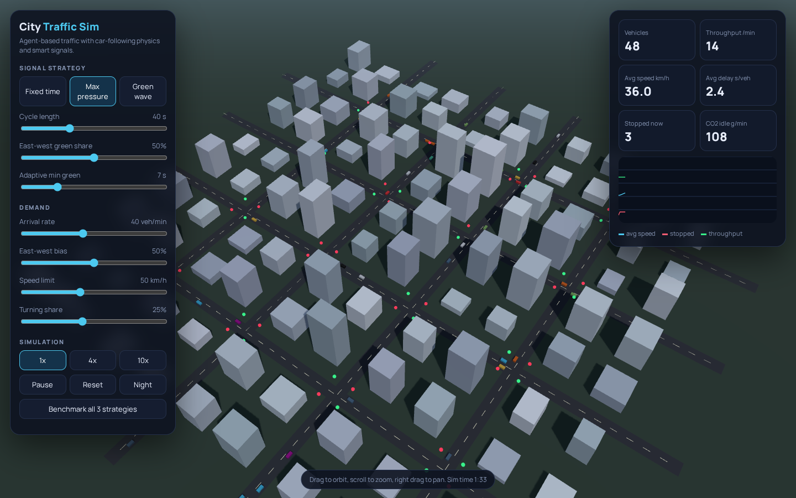

# City Traffic Sim

A 3D agent-based city traffic simulation with car-following physics, three signal control strategies, live KPIs and a built-in strategy benchmark.

**Live demo:** https://josephbepocode.github.io/city-traffic-sim/



## Features

- **Agents:** every vehicle follows the Intelligent Driver Model (IDM): desired speed, safe time headway and comfortable braking, reacting to the car ahead and to signals. Vehicles can turn at a chosen intersection.
- **Signal strategies:**
  - *Fixed time*: configurable cycle length and east-west green share with amber and all-red clearance.
  - *Max pressure*: adaptive, each intersection serves the approach with the larger weighted queue after a minimum green.
  - *Green wave*: coordinated offsets based on distance and speed limit, so east-west platoons ride a wave of greens.
- **Demand controls:** arrival rate, directional bias, speed limit, turning share.
- **KPIs:** vehicles in network, throughput per minute, average speed, average delay per vehicle, stopped vehicles, idle CO2 estimate, plus a live chart.
- **Benchmark:** runs 10 simulated minutes per strategy headlessly and reports delay and throughput for the current demand.
- **Scene:** 4 by 4 grid, instanced buildings and cars, day and night mode, orbit camera, 1x, 4x and 10x speed.

## Tech

three.js 0.160 (InstancedMesh, shadows, OrbitControls), vanilla JS simulation, Canvas 2D chart.

Fully static: no server, no API keys, no paid services. Hosted on GitHub Pages.

## Run locally

```bash
git clone https://github.com/josephbepocode/city-traffic-sim.git
cd city-traffic-sim
python3 -m http.server 8000
# open http://localhost:8000
```

## Notes and limitations

Roads are single lane per direction and turns happen at the intersection center, a deliberate simplification. CO2 is a rough idle-time estimate for comparison, not a calibrated emissions model.

## License

MIT, built by Deji ([@josephbepocode](https://github.com/josephbepocode)).
